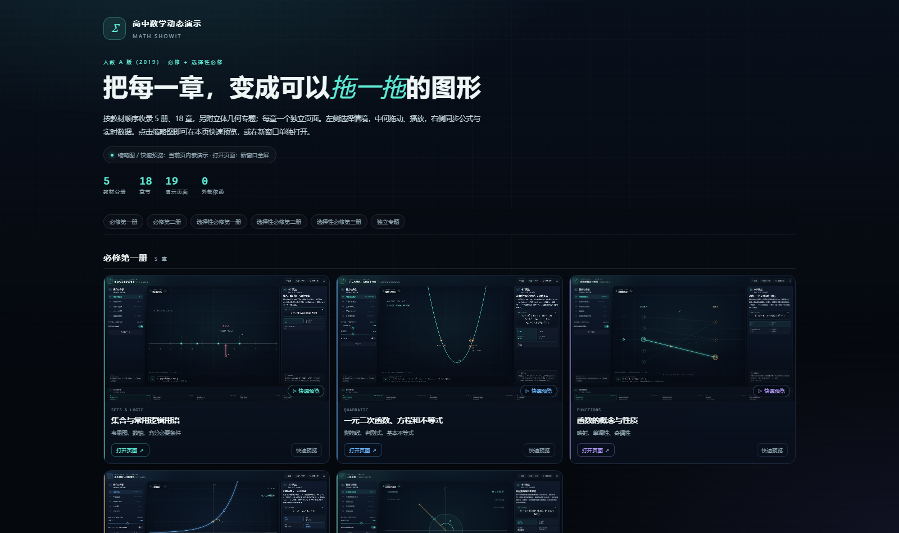

# 高中数学动态演示 · Math Showit

一套按人教 A 版（2019）教材顺序组织的高中数学动态教学网页：5 册、18 章，另附 1 个立体几何专题。每章一个可独立打开的单文件页面，用「左栏情境 + 中栏画布 + 右栏要点 + 底部图鉴」的结构，把概念、公式与图形联动起来。

原有的平面向量、圆锥曲线、空间向量与立体几何、直线和圆的方程四个独立演示，已分别整理进对应章节目录；平面切正方体作为独立专题保留。

打开根目录的 [index.html](index.html) 进入总览，选择章节；也可以直接双击任意章节目录下的 index.html。



> 无需联网、无需安装依赖、无需本地服务器。现代浏览器（Chrome / Edge / Firefox / Safari）直接打开即可。

---

## 快速开始

1. 双击根目录 index.html，按教材分册浏览 18 章。
2. 点击缩略图或「快速预览」在本页内嵌查看演示；「打开页面」在新窗口打开。
3. 在章节页左栏切换情境，拖动画布端点或调节滑块、开关。
4. 顶部「重置本节」恢复当前情境，「全屏」用于课堂投屏。
5. 键盘 ← / → 切换情境；带播放按钮的情境可用空格重播。

### 课堂使用建议

- **新授课**：先用第一个情境建立直观，再切到公式/运算情境，最后用应用情境收束。
- **复习课**：直接点底部「情境图鉴」跳转到目标情境，配合右栏实时数据讲解。
- **投屏**：进入全屏，隐藏浏览器地址栏；画布与数据会随窗口自适应。

---

## 教材结构

### 必修第一册

| 页面 | 内容 |
| --- | --- |
| [集合与常用逻辑用语](集合与常用逻辑用语/index.html) | 集合表示、关系与运算、充分必要条件、量词 |
| [一元二次函数、方程和不等式](一元二次函数方程和不等式/index.html) | 判别式、解集、基本不等式、标根法 |
| [函数的概念与性质](函数的概念与性质/index.html) | 映射、单调性、奇偶性、幂函数、最值 |
| [指数函数与对数函数](指数函数与对数函数/index.html) | 底数、图象、反函数、运算律、增长比较 |
| [三角函数](三角函数/index.html) | 单位圆、诱导公式、图象与变换 |

### 必修第二册

| 页面 | 内容 |
| --- | --- |
| [平面向量及其应用](平面向量及其应用/index.html)（既有项目） | 线性运算、基本定理、数量积、几何与物理应用 |
| [复数](复数/index.html) | 复平面、加减乘、共轭与模、轨迹 |
| [立体几何初步](立体几何初步/index.html) | 基本立体、表面积体积、线面平行与垂直 |
| [统计](统计/index.html) | 抽样、直方图、数字特征、百分位数 |
| [概率](概率/index.html) | 样本空间、古典概型、事件运算、频率与独立 |

### 选择性必修第一册

| 页面 | 内容 |
| --- | --- |
| [空间向量与立体几何](空间向量与立体几何/index.html)（既有项目） | 空间坐标系、法向量、线面角、二面角 |
| [直线和圆的方程](直线和圆的方程/index.html)（既有项目） | 斜率、直线方程、位置关系、圆的方程 |
| [圆锥曲线的方程](圆锥曲线的方程/index.html)（既有项目） | 椭圆、双曲线、抛物线、统一焦点—准线视角 |

### 选择性必修第二册

| 页面 | 内容 |
| --- | --- |
| [数列](数列/index.html) | 通项、等差、等比、前 n 项和、递推 |
| [一元函数的导数及其应用](一元函数的导数及其应用/index.html) | 平均/瞬时变化率、切线、单调性、极值 |

### 选择性必修第三册

| 页面 | 内容 |
| --- | --- |
| [计数原理](计数原理/index.html) | 加法与乘法原理、排列、组合、二项式定理 |
| [随机变量及其分布](随机变量及其分布/index.html) | 分布列、期望方差、二项分布、正态分布 |
| [成对数据的统计分析](成对数据的统计分析/index.html) | 散点图、回归直线、残差、独立性检验 |

---

## 独立专题

| 专题 | 页面 | 内容 |
| --- | --- | --- |
| 平面切正方体 | [平面切正方体](平面切正方体/index.html) | 三维旋转、平面切割、截面形状与全截面图鉴 |

---

## 每章页面结构

| 区域 | 内容 |
| --- | --- |
| 01 情境与参数 | 4–8 个情境的纵向列表、当前情境的滑块/开关/按钮、操作提示 |
| 中部舞台 | Canvas 动态图、当前情境徽标、底部核心公式与实时读数 |
| 02 本节要点 | 概念说明、公式卡、3–5 项实时数据、观察提示 |
| 03 情境图鉴 | 若干张情境卡片，点击切换并与左栏联动 |

配色：每个情境使用独立主题色；同一页内导航、数据卡、公式条与画布同步换色。

---

## 目录结构

    数学演示/
     index.html                 总导航（18 章 + 1 专题，分册导航 + 缩略图 + 内嵌预览）
     preview.png                总导航预览图
     README.md                  本说明
     LICENSE                    MIT 许可
     _template/                 统一模板、构建脚本、章节清单与源码归档
    _template/src/             14 章构建源文件 + 圆锥曲线/截面专题研究资料
     集合与常用逻辑用语/
     一元二次函数方程和不等式/
     函数的概念与性质/
     指数函数与对数函数/
     三角函数/
     平面向量及其应用/    既有独立项目
     复数/
     立体几何初步/
     统计/
     概率/
     空间向量与立体几何/  既有独立项目
     直线和圆的方程/      既有独立项目
     圆锥曲线的方程/      既有独立项目
     数列/
     一元函数的导数及其应用/
     计数原理/
     随机变量及其分布/
     成对数据的统计分析/
     平面切正方体/               独立专题（三维截面演示）

每个章节目录直接位于根目录，并以章节名称命名，**只保留 `index.html`、`README.md`、`preview.png` 三个文件**。`index.html` 已内联全部资源，单独复制即可运行；构建源文件统一归档在 `_template/src/`，不随章节分发。

---

## 技术说明

- **单文件交付**：每章的 HTML、CSS、JavaScript 全部内联，无 CDN、无外部图片/字体、无网络请求。
- **统一引擎**：按模板生成的 14 章共用 template.html 中的布局与 Canvas 引擎（坐标变换、箭头、角弧、手柄拖动、整幅画布旋转、DPR 缩放、响应式三栏）；4 个既有项目保留各自引擎。
- **章节内容**：按统一模板生成的章节，其 `meta.json` 与 `modules.js` 统一放在 `_template/src/<章>/`，构建脚本负责合并到章节目录的 `index.html`（既有的四个独立项目保留原结构，不经过构建）。修改后运行：

      python3 _template/build.py all
      python3 _template/build.py 集合与常用逻辑用语

- **新增一章**：复制 `_template/src` 中的源目录 → 修改 meta.json → 按 GUIDE.md 重写 modules.js → 运行构建脚本 → 在 manifest.json 中登记 → 运行 `make_readmes.py` 与 `portal.py` 更新说明和总览。

---

## 验证与兼容性

- 19 个页面均在 Edge 无头浏览器中逐节激活全部情境并检查 HUD、画布与控件，未出现 JavaScript 运行时错误、NaN 读数或外部网络请求。
- 18 个章节页面在 390×844 移动视口检查，无页面级横向溢出；模板章节的长英文标签在窄屏自动隐藏。
- 桌面端在 1920×1080、1366×600 等视口回归，低高度窗口会压缩顶栏与图鉴，不再裁切页面底部。
- 每个章节目录均提供 preview.png 预览图；总览页使用缩略图并支持页内 iframe 预览。
- 依赖 Canvas 2D、CSS 自定义属性与 ES2015+，不兼容 IE。

---

## 说明与边界

- 平面向量、圆锥曲线、空间向量与立体几何、直线和圆的方程四章直接使用原有独立项目，保留其页面结构、快捷键与参数；其余 14 章由统一模板生成。
- 立体几何、空间向量、平面切正方体章节使用 Canvas 2D 的正投影/斜二测画法表现三维对象；画布可拖动旋转，空间向量与截面专题还支持滚轮缩放，但不是完整的 3D 渲染引擎。
- 各章图形按当前视野取景，拖动端点被限制在画布内；统计、概率、数列等章节的数据为课堂演示用的可调样本，不追求真实数据的规模。
- 模板章节刷新后回到第一个情境，不保存滑块状态；四个既有项目支持各自的 URL 参数与快捷键，详见对应目录的 README。
- `index.html` 是每章的唯一运行文件；归档的 `meta.json` 与 `modules.js` 仅用于构建，不会在运行时被请求。

---

## 仓库与许可

```bash
git clone https://github.com/bunus/math_showit.git
```

进入任意演示目录，用浏览器打开 index.html 即可。本项目采用 [MIT License](LICENSE)。
