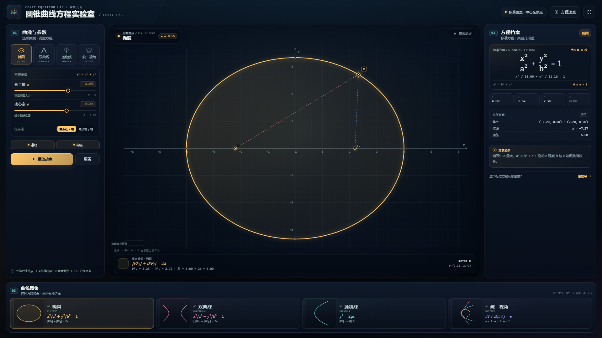

# 圆锥曲线方程实验室 · Conic Equation Lab

一个可直接双击打开的中文动态教学网页，用同一个焦点—准线定义串起**椭圆、双曲线、抛物线**，并实时展示标准方程、焦点、准线、离心率与动点 P 的定义关系。

> 无需联网、无需安装依赖、无需本地服务器。用浏览器打开 `index.html` 即可。



## 四种观察视角

| 模式 | 坐标原点 | 标准方程 / 核心关系 |
|---|---|---|
| 椭圆 | 中心 O | `x²/a² + y²/b² = 1`，`PF₁ + PF₂ = 2a` |
| 双曲线 | 中心 O | `x²/a² − y²/b² = 1`，距离差绝对值为 `2a` |
| 抛物线 | 顶点 O | `y² = 2px`，`PF = d(P, ℓ)` |
| 统一视角 | 焦点 F | `r = ℓ / (1 − e cos θ)`，`PF / d(P, ℓ) = e` |

- **椭圆 / 双曲线 / 抛物线**：以标准位置呈现；滑杆实时改变 `a、e、p`，可切换“焦点轴 / 实轴 / 开口方向”。
- **统一视角**：焦点固定在原点，准线在左侧，调 `e` 让曲线连续地从椭圆变到抛物线、再到双曲线；`ℓ` 控制大小。
- **动态点 P**：始终由当前模式的参数方程生成，并用实际 hypot 距离验证定义不变量，避免“公式和画出的点不一致”。
- **空间关系**：画布等比例缩放、y 轴向上；准线、渐近线、焦点、顶点、P 到焦点/准线的辅助线均可在图中读取。
- **教学档案**：右侧同步显示符号方程、数值方程、几何量、几何要素与随参数变化的观察提示。
- **推导速查**：点击“方程速查”打开完整推导、方程识别、常见错误与课堂演示路线。

## 统一视角的两个细节

1. **`e > 1` 是整条双曲线**。按焦点—准线定义（距离比取绝对值），两支上的点到**同一焦点 F、同一准线 ℓ** 的距离比都等于 `e`。极坐标 `r > 0` 只能描出含焦点的一支；页面用关于中心对称的方法补画出另一支。
2. **`e → 1` 时的视野裁剪**。固定 `ℓ` 时，椭圆右端或双曲线远端会跑到很远；页面以 `R = 5ℓ` 截取视野内的曲线段，并在图中明确说明“端点在视野边界处断开”，不会用虚假的直线把曲线闭合。

## 操作

- 拖动滑杆调整参数；切换顶部曲线标签或底部图鉴卡片切换模式。
- `空格`：暂停 / 播放动点
- `1` / `2` / `3` / `4`：切换四种模式
- `R`：重置当前模式参数
- `G`：打开 / 关闭方程速查
- `Esc`：关闭方程速查

## URL 参数（方便课堂投屏或截图）

```text
index.html?mode=ellipse&a=4&e=0.55&axis=x&static=1&t=0.95
index.html?mode=hyperbola&a=2.2&e=1.45&axis=y&static=1&t=1.2
index.html?mode=parabola&p=3&axis=x&static=1&t=1.2
index.html?mode=unified&e=1.6&l=2.5&static=1&t=2.0
```

- `mode`：`ellipse / hyperbola / parabola / unified`
- `axis`：`x / y`（统一视角忽略）
- `a / e / p / l`：对应模式参数
- `t`：动点相位；`static=1` 暂停动画，适合截图
- `paused=1` 也可暂停

## 目录

- `index.html`：单文件应用（HTML + CSS + 原生 Canvas JavaScript）
- `README.md`：本说明
- `preview.png`：1920×1080 预览图

本章目录只保留这三个交付文件；数学参考、预设与核验脚本归档在 `_template/src/圆锥曲线的方程/research/`，不随章节分发。

## 数学核验

独立数值核验脚本从定义与隐式方程出发，抽样核验了标准方程、焦点/准线、渐近线、统一定义与定义不变量。最近一次运行：

- **350 项检查全部 PASS**
- 严格容差 `1e-9` 下最大误差 **5.46e-12**
- 退出码 0

开发过程中还在 1920×1080 / 1366×768 / 1024×800 / 390×844 四视口上完成 385/385 项浏览器自动化检查，0 失败（无 JS 错误、无页面级横向溢出、四模式数学读数与独立复算一致）。

> 说明：归档预设中的 U3（l=1）与 U5（e=0）超出页面统一视角滑杆范围，仅作数学边界示例；页面会安全夹取到 UI 范围内，不会报错。

页面本身还会在运行时根据当前 P 的坐标重新计算距离，并在“定义验证”栏显示：

- 椭圆：`PF₁ + PF₂ = 2a`
- 双曲线：`| |PF₁| − |PF₂| | = 2a`
- 抛物线：`PF = d(P, ℓ)`
- 统一视角：`PF / d(P, ℓ) = e`

## 说明

- 页面无外网依赖，所有图形、字体与动画均使用系统能力。
- 统一视角与标准模式的**坐标原点含义不同**：统一视角的原点在焦点，其他模式在中心或顶点；页面顶部与画布左下角均有标注。
- 桌面端与移动端均可用；移动端为纵向长页面，先看图，再调参数、读方程。
