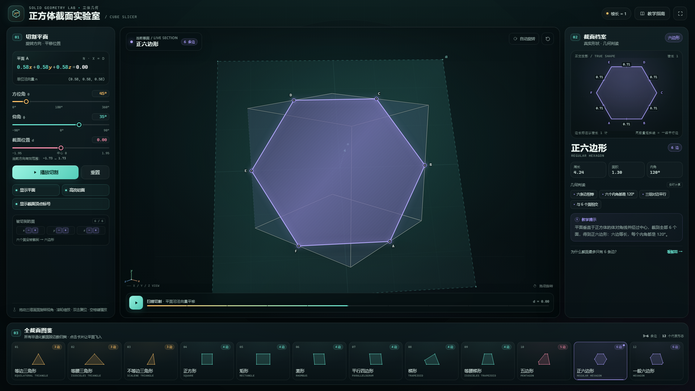

# 正方体截面实验室 · Cube Cross-Section Lab

一个用于立体几何教学的单文件前端演示：一张平面穿过正方体，实时显示切出的截面，并用二维“真实形状”视图、动态几何判读和全截面图鉴，把正方体所有非退化截面类型讲清楚。

直接用浏览器打开 [index.html](index.html) 即可，**无需联网、无需安装依赖、无需启动服务**。



---

## 快速开始

1. 双击 `index.html`（推荐 Chrome / Edge / Firefox / Safari 近年版本）。
2. 拖动三维画面旋转视角，滚轮缩放，双击复位。
3. 拖动三个滑块改变平面；或点击下方图鉴，让平面自动“飞”到对应截面。
4. 点击“播放切割”，观察平面扫过正方体时截面从 3 条边逐步变成 6 条边。
5. 点击右上角“教学指南”，查看每一类截面的形成条件、证明要点和常见误区。

键盘：空格播放/暂停，`R` 复位视角，`G` 打开教学指南，`Esc` 关闭指南。

### 课堂演示路线

建议按下面的顺序使用：

1. **正方形**：从最直观的“平面平行于一个面”开始；
2. **正六边形**：把平面转到垂直于体对角线且过中心的位置；
3. **等边三角形**：把平面平移到靠近顶点的位置；
4. 最后用“播放切割”连续扫描，观察截面边数怎样变化。

---

## 界面说明

| 区域 | 内容 |
| --- | --- |
| 01 切割平面 | 平面方程、单位法向量、方位角 θ / 仰角 φ / 位置 d、显示开关、播放与重置 |
| 中部三维舞台 | 正方体、切割平面、被高亮的面、截面多边形、顶点标号、法向量 n、坐标轴三面角 |
| 02 截面档案 | 截面的正交投影真实形状、边长、平行记号、直角记号、周长/面积/内角、实时分类与教学提示 |
| 03 全截面图鉴 | 12 个代表性截面，按 3 / 4 / 5 / 6 条边分组；点击后平面平滑飞入 |

### 预设列表

三角形（3 边）：等边三角形、等腰三角形、不等边三角形

四边形（4 边）：正方形、矩形、菱形、平行四边形、梯形、等腰梯形

五边形（5 边）：五边形

六边形（6 边）：正六边形、一般六边形

### URL 参数（适合课堂固定画面或截图）

- `?preset=regular-hexagon`：直接打开某个预设，例如 `?preset=square`；
- `?static=1`：预设直接生效，不做进入动画；
- `?yaw=0.68&pitch=0.31&dist=7.25`：固定相机角度；
- 可用 preset id：`equilateral-triangle`, `isosceles-triangle`, `scalene-triangle`, `square`, `rectangle`, `rhombus`, `parallelogram`, `trapezoid`, `isosceles-trapezoid`, `pentagon`, `regular-hexagon`, `hexagon`。

例如：

```text
index.html?preset=regular-hexagon&static=1
```

---

## 数学内容

数学上，平面 n·x = d（n 为单位法向量）与单位正方体 [-1,1]³ 的交集是一个凸多边形。截面的每一条边都落在正方体的某一个面上，所以：

> **正方体的非退化截面只可能是三角形、四边形、五边形或六边形。**

不是“只有这 6 种固定形状”，而是截面位置连续变化会产生无穷多种大小和比例；教学上按**边数 + 特殊形状**来完备归类。

| 边数 | 形成条件 | 结论与特殊形态 |
| --- | --- | --- |
| 3 | 平面截去一个顶点附近的角，只与过该顶点的三个面相交 | 截面恒为**锐角三角形**，不会出现直角或钝角三角形；可实现等边、等腰非等边、不等边 |
| 4 | 平面与 4 个面相交 | 至少有一组对边平行；可实现正方形、矩形、菱形、一般平行四边形、梯形、等腰梯形。严格非平行四边形的“直角梯形”不会出现 |
| 5 | 平面与 5 个面相交 | 必有两组平行边；**正五边形不可能出现** |
| 6 | 平面与全部 6 个面相交 | 三组对边分别平行；当且仅当平面垂直于体对角线且过中心时为正六边形 |

退化情形：平面与顶点相切得到点，沿棱相切得到线段，与一个面重合得到正方形面；这些通常不计入“截面”。

补充说明：

- 三角形截面的三个角都为锐角。若三条截棱长为 x、y、z，则三边为 √(x²+y²)、√(y²+z²)、√(z²+x²)，可证明每个内角的余弦都为正。
- 四边形截面至少有一组对边平行。仅根据“截到了几组对面”判断形状容易出错；矩形与平面的法向量含零分量密切相关，而菱形可以在不平行于任何面的情况下出现。
- 五边形截面必有两组平行边，因此不可能是正五边形。
- 六边形截面一定有三组对边平行；但“三组对边平行”并不自动意味着中心对称或正六边形。

更完整的推导、教学要点、常见错误和程序验证记录见 [research/section-taxonomy.md](research/section-taxonomy.md)。

---

## 验证与兼容性

- 12 个预设均通过数值检查：截面顶点在正方体内、截面为二维非退化凸多边形、边数与形状分类一致、平面不经过顶点或棱、最小交点参数有余量。
- 独立 QA 在最终文件上完成 239 项自动化检查（161 + 78），全部通过；覆盖 12 个预设、数学断言、交互、4 个视口布局和基础可访问性。
- 已在 1920×1080、1366×768、1024×768、390×844 等视口检查布局。
- 兼容支持 Canvas 2D、CSS 自定义属性和 ES2015+ 的现代浏览器。
- 单个 HTML 文件，不需要服务器；三维渲染与截面计算均为原生 Canvas 2D / 向量运算，没有外部库或网络请求。

自动验收报告见 [qa/report.md](qa/report.md)。

---

## 文件结构

```text
index.html                  单文件教学演示（全部 HTML/CSS/JS）
README.md                   本说明
research/
  section-taxonomy.md       截面分类教学手册与证明
  presets.json              预设、精确构造与验证数据
  verify_presets.py         独立数值验证脚本
  verification.txt          验证输出
qa/                         独立验收报告与截图（由 QA 生成）
```

---

## 已知边界

- 截面分类使用少量数值容差来识别“相等/平行/直角”。在极其接近退化或接近特殊形状的位置，名称可能按容差归入最接近的类型；预设位置均有意避开了这些临界点。
- 动画为无限往返扫描，便于课堂反复观察；可随时暂停或手动拖动位置。
- 本演示的“棱长 = 1”是显示计量约定；三维坐标内部仍使用 [-1,1]³，二维图的长度与面积均按棱长 1 换算。
