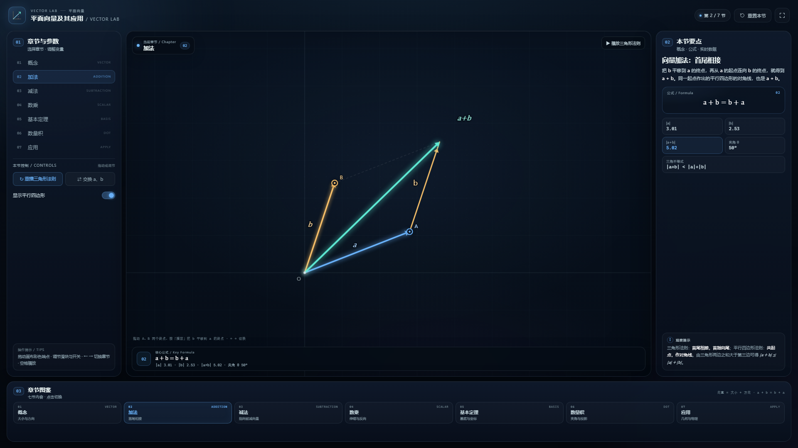

# 平面向量及其应用 · Vector Lab

一个用于平面向量章节教学的单文件前端演示：把向量的概念、线性运算、基本定理、数量积，以及余弦定理、斜面受力、小船渡河三类应用，放进同一套可拖拽、可播放的动态图形里。

直接用浏览器打开 [index.html](index.html) 即可，**无需联网、无需安装依赖、无需启动服务**。



---

## 快速开始

1. 双击 `index.html`（推荐 Chrome / Edge / Firefox / Safari 近年版本）。
2. 在左栏「章节与参数」中点击 01–07 切换章节，或点击底部「章节图鉴」卡片。
3. 拖动画布中的彩色端点改变向量，调节左栏滑块、开关和按钮观察变化。
4. 点击顶部「重置本节」恢复初始状态；「全屏」用于课堂投屏。
5. 「加法」一节可点击右上角「播放三角形法则」，观看 b 平移到 a 的终点的过程。

键盘：`←` / `→` 切换章节，`空格` 播放/重播加法动画（仅「加法」一节响应）。

### 课堂演示路线

建议按下面的顺序使用：

1. **概念**：拖动 A、B，先建立“大小 + 方向”的直观，再打开相等向量、相反向量、单位向量与零向量；
2. **加法**：播放三角形法则，再打开平行四边形，交换 a、b 验证 `a + b = b + a`；
3. **减法**：观察 `a − b` 始终由 b 的终点指向 a 的终点，并对照两条对角线；
4. **数乘 → 基本定理**：用 λ 滑块看共线伸缩，再把 θ 调到 0° 看“不能构成基底”，调回 90° 讲正交分解；
5. **数量积**：看投影长度与符号，点击“旋转 b 至垂直”验证 `a · b = 0`；
6. **应用**：依次切换余弦定理、力的分解、小船过河，把向量运算落到几何与物理情境中。

---

## 界面说明

| 区域 | 内容 |
| --- | --- |
| 01 章节与参数 | 七节纵向导航、当前节的滑块/开关/按钮、操作提示 |
| 中部舞台 | 可拖拽的向量图形；左上角当前章节徽标；底部公式条（核心公式 + 实时读数）；「加法」节的播放按钮 |
| 02 本节要点 | 概念说明、公式卡、双列实时数据卡、观察提示 |
| 03 章节图鉴 | 七张章节卡片，点击切换并与左栏导航联动高亮 |

颜色约定：蓝色为向量 **a**，金色为向量 **b**，青色为结果（和、投影目标、v 等），玫红为差向量/投影/相反向量，紫色为 `λa`。

---

## 七节内容

| 节 | 核心公式 | 可交互与观察点 |
| --- | --- | --- |
| 01 概念 | `\|a\| = √(x² + y²)` | 拖动 A、B；显示平移后的相等向量、相反向量 −a、单位向量 e 与零向量 0；实时显示模、方向角、坐标 |
| 02 加法 | `a + b = b + a` | 播放三角形法则；显示平行四边形；交换 a、b；实时比较 `|a+b|` 与 `|a|+|b|` |
| 03 减法 | `a − b = a + (−b)` | 显示 a+b 对角线、平行四边形、−b 与 a+(−b)；实时验证 `|a+b|² + |a−b|² = 2(|a|²+|b|²)` |
| 04 数乘 | `\|λa\| = \|λ\| · \|a\|` | λ ∈ [−2, 2] 滑块、自动演示、λ = ±1 快捷键；观察同向、反向、零向量与共线刻度 |
| 05 基本定理 | `v = x e₁ + y e₂` | 拖动 v、调节基底夹角 θ；实时解出唯一坐标 (x, y)；θ = 0°/180° 时提示基底共线 |
| 06 数量积 | `a · b = \|a\|\|b\| cos θ` | 显示 b 在 a 上的投影（含负投影）；旋转 b 至垂直；实时给出 cos θ、a·b 与锐角/直角/钝角判定 |
| 07 应用 | 见下文 | 余弦定理（拖动 C、一键直角）、力的正交分解（斜面倾角）、小船渡河（水速/船速/船头方向） |

### 07 应用的三条支线

- **余弦定理**：在 △ABC 中，`BC = AC − AB`，两边平方并用数量积展开，得到 `|BC|² = |AC|² + |AB|² − 2 AC·AB`，即 `a² = b² + c² − 2bc cos A`。拖动顶点 C 可改变角 A，右侧实时比对等式两边。
- **力的分解**：物体在倾角为 θ 的斜面上，重力 G 分解为沿斜面的 `G sin θ` 与垂直斜面的 `G cos θ`；图中同时画出支持力 N 与分解的平行四边形。演示取 G = 10 N，受力箭头按 0.14 个单位/N 示意绘制。
- **小船渡河**：合速度 `v合 = v船 + v水`；渡河时间 `t = d / (v船 sin α)`，漂移距离为 `(v水 + v船 cos α) · t`。画布中河宽 d 取 4 个长度单位作示意，读数由公式实时计算。

---

## 数学内容

### 1. 向量与表示

向量既有大小又有方向，用有向线段表示：线段长度是模，箭头指向是方向。向量平移后仍是同一个向量（自由向量）；方向相同或相反的非零向量叫平行向量（共线向量）；长度为 1 的向量是单位向量。

### 2. 线性运算

- **三角形法则**：首尾相接，首指向尾；**平行四边形法则**：共起点，作对角线。
- 三角不等式：`|a + b| ≤ |a| + |b|`，当且仅当 a、b 同向时取等号。
- 减法：共起点时，`a − b` 从 b 的终点指向 a 的终点；`a − b = a + (−b)`。
- 数乘：`|λa| = |λ||a|`；λ > 0 同向，λ < 0 反向，λ = 0 得零向量。
- 共线定理：对非零向量 a，`b = λa` ⇔ `a ∥ b`（λ 唯一）。

### 3. 平面向量基本定理

若 e₁、e₂ 不共线，则平面内任意向量 v 存在唯一一对实数 (x, y)，使 `v = x e₁ + y e₂`。程序中直接解线性方程组：

```text
x = det(v, e₂) / det(e₁, e₂)
y = det(e₁, v) / det(e₁, e₂)
```

当 `det(e₁, e₂) = 0`（θ = 0° 或 180°）时基底共线，页面会明确提示“不能作为基底”。

### 4. 数量积

`a · b = |a||b| cos θ = x₁x₂ + y₁y₂`，结果是实数。几何意义是 b 在 a 方向上的投影长度与 |a| 的乘积：

- 投影 `|b| cos θ` 为正、为零、为负，分别对应锐角、直角、钝角；
- `a · b = 0` ⇔ `a ⊥ b`（非零向量）；
- `a · a = |a|²`，常用于求模长。

### 5. 几何与物理应用

- **余弦定理**：由 `BC = AC − AB` 两边平方得到；向量方法把长度关系转化为数量积运算。
- **正交分解**：选互相垂直的两个方向（沿斜面、垂直斜面），使多数力只落在一个方向上。
- **速度合成**：船的实际速度是船速与水速的矢量和；垂直河岸的分速度决定渡河时间，沿河岸的分速度造成漂移。

---

## 操作与交互

| 操作 | 效果 |
| --- | --- |
| 拖动画布彩色端点 | 改变向量或动点（端点带环形手柄，悬停变手型） |
| 拖动左栏滑块 | 改变 λ、θ、斜面倾角、水速/船速/船头方向等参数 |
| 开关 | 显示/隐藏辅助向量、平行四边形、投影等 |
| 「重置本节」 | 恢复当前章节的默认参数与显示状态 |
| 「全屏」 | 进入/退出浏览器全屏，适合投屏 |
| `←` / `→` | 切换上一节 / 下一节 |
| `空格` | 重播加法动画（仅「加法」一节） |

---

## 设计说明

- **单文件**：HTML、CSS、原生 Canvas 2D JavaScript 全部写在 `index.html` 内，无外部字体、图片、CDN 或网络请求。
- **布局**：沿用同系列项目的三栏工作区（章节与控制 / 舞台 / 要点与数据）+ 底部章节图鉴；编号 01–03 分区，窄屏自动改为纵向堆叠。
- **绘图**：Canvas 按 devicePixelRatio 缩放，世界坐标与屏幕坐标分离；每个章节使用独立主题色，切换时联动导航、数据卡、公式条与画布。
- **可读性**：画布文字随缩放比例自动调整字号，并带深色描边，避免压在箭头光晕上时看不清。

---

## 文件结构

```text
index.html    单文件教学演示（全部 HTML / CSS / JS）
README.md     本说明
preview.png   1920×1080 预览图（“加法”一节）
```

---

## 验证与兼容性

- 在 Edge 无头浏览器中逐节切换 7 个章节，并模拟调节全部滑块、点击全部按钮与“应用”三个子情境，未出现 JavaScript 错误。
- 在 1920×1080、1600×950、1200×820、500×900 等视口检查过布局，无页面级横向溢出；移动端按“舞台 → 章节与控制 → 要点 → 图鉴”堆叠。
- 兼容支持 Canvas 2D、CSS 自定义属性与 ES2015+ 的现代浏览器。

---

## 已知边界

- 画布端点拖动被限制在当前视野内，向量不会拖出画布。
- 斜面受力图与渡河图使用示意比例：G = 10 N 按 0.14 个单位/N 绘制，河宽取 4 个单位；右侧读数由公式独立计算，二者不构成测量比例。
- 当基底夹角接近 0° 或 180° 时，分解系数会迅速增大并被视野裁剪，页面以“共线，不能作为基底”提示这一退化情形。
- 减法、数乘、数量积等以拖动和滑块驱动为主，只有「加法」提供自动播放按钮。
- 页面不保存参数，也不支持 URL 预置；刷新后回到「概念」一节。