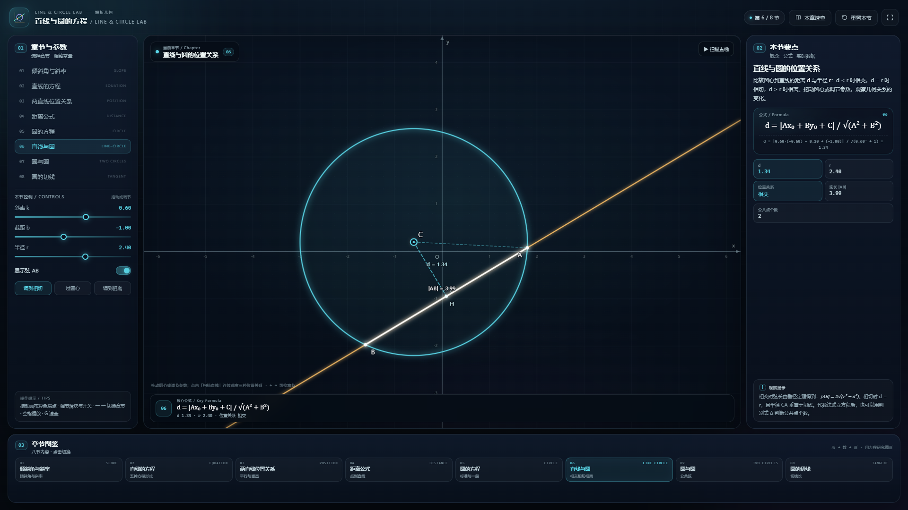

# 直线与圆的方程 · Line & Circle Lab

一个用于解析几何章节教学的单文件前端演示：把倾斜角与斜率、直线方程、两直线位置关系、距离公式、圆的方程、直线与圆/圆与圆的位置关系以及圆的切线，放进同一套可拖拽、可播放的动态图形里。

直接用浏览器打开 [index.html](index.html) 即可，**无需联网、无需安装依赖、无需启动服务**。



---

## 快速开始

1. 双击 `index.html`（推荐 Chrome / Edge / Firefox / Safari 近年版本）。
2. 在左栏「章节与参数」中点击 01–08 切换章节，或点击底部「章节图鉴」卡片。
3. 拖动画布中的彩色端点（A、B、P、圆心等）改变图形；调节滑块、开关和按钮观察变化。
4. 点击顶部「本章速查」查看八节公式、判定方法与常见易错点；「重置本节」恢复默认状态。
5. 「全屏」适合课堂投屏。

键盘：`←` / `→` 切换章节，`空格` 播放/暂停（仅 01、06 响应），`R` 重置本节，`G` 打开/关闭本章速查，`Esc` 关闭速查。

### 课堂演示路线

建议按下面的顺序使用：

1. **01 倾斜角与斜率**：拖动 A、B，观察 α 从 0° 到 180° 时 k 的符号与大小；停在 90° 说明斜率不存在。
2. **02 直线的方程**：切换点斜式、斜截式、两点式、截距式、一般式，比较同一条直线的不同写法与适用条件。
3. **03 两直线位置关系**：用方向向量端点摆出平行、垂直、相交、重合，观察交点与夹角。
4. **04 距离公式**：拖动 P 看点线距离的变化，再切换到两平行线，验证“系数相同再作差”。
5. **05 圆的方程**：由标准方程展开到一般方程；把判别式调成 0 与负数，观察图形退化。
6. **06 直线与圆**：点击「扫描直线」连续观察相交 → 相切 → 相离，以及弦长的变化。
7. **07 圆与圆**：拖动圆心、调节半径，依次经过五种位置关系，观察公共弦的出现与消失。
8. **08 圆的切线**：拖动 P，验证两条切线长相等、PT ⊥ CT，并打开辅助圆看切点弦。

---

## 界面说明

| 区域 | 内容 |
| --- | --- |
| 01 章节与参数 | 八节纵向导航、当前节的滑块/开关/按钮、操作提示 |
| 中部舞台 | 可拖拽的直线与圆；左上角当前章节徽标；底部公式条（核心公式 + 实时读数） |
| 02 本节要点 | 概念说明、公式卡与数值方程、实时数据卡、观察提示 |
| 03 章节图鉴 | 八张章节卡片，点击切换并与左栏导航联动高亮 |

颜色约定：金色/蓝色用于两条直线，紫色用于圆，青色用于直线与圆，玫红与金色用于两个圆，绿色用于切线。

---

## 八节内容

| 节 | 核心公式 | 可交互与观察点 |
| --- | --- | --- |
| 01 倾斜角与斜率 | `k = tan α = (y₂−y₁)/(x₂−x₁)` | 拖动 A、B；显示斜率三角形 Δy/Δx；按钮快速取 α = 45° / 135° / 90°；播放旋转 |
| 02 直线的方程 | `y − y₀ = k(x − x₀)` 等五种形式 | 拖动 P、调节 k；切换点斜式 / 斜截式 / 两点式 / 截距式 / 一般式；显示截距与斜率三角形 |
| 03 两直线位置关系 | `r₁ ∥ r₂ ⇔ x₁y₂−x₂y₁=0`，`r₁ ⊥ r₂ ⇔ x₁x₂+y₁y₂=0` | 拖动四条端点；实时判定平行 / 垂直 / 相交 / 重合；显示交点与夹角；“设为…”按钮一键摆位 |
| 04 距离公式 | `d = |Ax₀+By₀+C| / √(A²+B²)` | 点到直线 / 两平行线两种模式；拖动 P；显示垂足、直角标记与距离 |
| 05 圆的方程 | `(x−a)²+(y−b)²=r²`，`x²+y²+Dx+Ey+F=0` | 标准方程：拖动圆心、调节半径；一般方程：调节 D、E、F，观察判别式大于 / 等于 / 小于 0 |
| 06 直线与圆 | `d = |Ax₀+By₀+C| / √(A²+B²)`，`l = 2√(r²−d²)` | 拖动圆心，调节 k、b、r；显示弦 AB、垂足与距离；扫描直线观察三种位置关系 |
| 07 圆与圆 | `|r₁−r₂| < d < r₁+r₂`（相交） | 拖动两个圆心，调节半径；显示圆心距、公共弦 / 根轴；外切 / 相交 / 内切 / 外离按钮 |
| 08 圆的切线 | `|PT| = √(|PC|²−r²)` | 拖动 P 与圆心；显示两条切线、切点、切线长、夹角、切点弦；辅助圆与 60° 预设 |

---

## 数学内容

### 1. 倾斜角与斜率

直线向上的方向与 x 轴正方向所成的角 α 叫做倾斜角，范围是 `[0°, 180°)`。斜率

```text
k = tan α = (y₂ − y₁) / (x₂ − x₁)   （x₁ ≠ x₂）
```

当 α = 90° 时斜率不存在；水平线的斜率为 0。倾斜角从 0° 增大到 90° 时 k 从 0 趋向 +∞，从 90° 增大到 180° 时 k 从 −∞ 增大到 0。

### 2. 直线方程的五种形式

| 形式 | 方程 | 限制 |
| --- | --- | --- |
| 点斜式 | `y − y₀ = k(x − x₀)` | 不能表示斜率不存在的直线 |
| 斜截式 | `y = kx + b` | 不能表示斜率不存在的直线 |
| 两点式 | `(y−y₁)/(y₂−y₁) = (x−x₁)/(x₂−x₁)` | 两点连线不能竖直或水平 |
| 截距式 | `x/a + y/b = 1` | 两个截距都不为 0 |
| 一般式 | `Ax + By + C = 0` | A、B 不同时为 0，可表示所有直线 |

截距是坐标，不是距离，可以为负。一般式是课堂推导与判定位置关系时最通用的形式。

### 3. 位置关系与距离

两条直线用方向向量 `r₁=(x₁,y₁)`、`r₂=(x₂,y₂)` 表示：

```text
r₁ ∥ r₂ ⇔ x₁y₂ − x₂y₁ = 0
r₁ ⊥ r₂ ⇔ x₁x₂ + y₁y₂ = 0
```

点 `P(x₀,y₀)` 到直线 `Ax+By+C=0` 的距离为

```text
d = |Ax₀ + By₀ + C| / √(A² + B²)
```

两条平行线 `Ax+By+C₁=0`、`Ax+By+C₂=0` 之间的距离为

```text
d = |C₁ − C₂| / √(A² + B²)
```

### 4. 圆的方程

标准方程 `(x−a)²+(y−b)²=r²` 直接给出圆心 `(a,b)` 与半径 r。展开并整理成一般式

```text
x² + y² + Dx + Ey + F = 0
```

配方得

```text
(x + D/2)² + (y + E/2)² = (D² + E² − 4F) / 4
```

因此当 `D²+E²−4F>0` 时表示圆，圆心 `(−D/2,−E/2)`，半径 `½√(D²+E²−4F)`；等于 0 时表示一个点；小于 0 时不表示图形。

### 5. 直线与圆、圆与圆

直线与圆：设圆心到直线的距离为 d，半径为 r，则

- `d < r`：相交，弦长 `|AB| = 2√(r²−d²)`；
- `d = r`：相切，半径垂直于切线；
- `d > r`：相离。

圆与圆：设圆心距为 d，两半径为 r₁、r₂，则

- `d > r₁+r₂`：外离；
- `d = r₁+r₂`：外切；
- `|r₁−r₂| < d < r₁+r₂`：相交；
- `d = |r₁−r₂|`：内切；
- `d < |r₁−r₂|`：内含。

两圆相交时，两圆方程相减可消去 x²、y² 项，得到公共弦所在直线；公共弦长用垂径定理计算。

### 6. 圆的切线

过圆外一点 P 可作圆的两条切线，切点为 T₁、T₂。由直角三角形 PCT：

```text
|PT| = √(|PC|² − r²)，PT ⊥ CT
```

两条切线长相等。以 PC 为直径的圆与圆 C 的两个交点正是 T₁、T₂；两圆方程相减可得切点弦 T₁T₂ 所在直线。

---

## 操作与交互

| 操作 | 效果 |
| --- | --- |
| 拖动画布彩色端点 | 改变直线方向、定点位置、圆心或半径端点 |
| 拖动左栏滑块 | 改变斜率、截距、半径、D/E/F 等参数 |
| 开关 | 显示/隐藏斜率三角形、截距、垂足、弦、辅助圆、切点弦等 |
| 「本章速查」 | 打开八节公式、易错点与课堂路线 |
| 「重置本节」 | 恢复当前章节的默认参数与显示状态 |
| `←` / `→` | 切换上一节 / 下一节 |
| `空格` | 播放/暂停旋转或扫描（仅 01、06） |
| `R` | 重置本节 |
| `G` / `Esc` | 打开 / 关闭本章速查 |

### URL 参数

```text
index.html?section=6
index.html?section=tangent
```

- `section` 可写 1–8 的数字，也可写章节 key：`slope`、`equation`、`position`、`distance`、`circle`、`lineCircle`、`twoCircles`、`tangent`。
- 适合课堂固定打开某一节，或截图时复用链接。

---

## 设计说明

- **单文件**：HTML、CSS、原生 Canvas 2D JavaScript 全部写在 `index.html` 内，无外部字体、图片、CDN 或网络请求。
- **布局**：沿用同系列项目的三栏工作区（章节与控制 / 舞台 / 要点与数据）+ 底部章节图鉴；编号 01–03 分区，窄屏自动改为纵向堆叠。
- **绘图**：Canvas 按 `devicePixelRatio` 缩放，世界坐标与屏幕坐标分离；坐标网格、刻度与点标签随画面缩放调整字号，并带深色描边。
- **交互**：端点在视野内可自由拖动；数值数据实时更新，公式卡同时给出符号式与当前数值式。

---

## 文件结构

```text
index.html    单文件教学演示（全部 HTML / CSS / JS）
README.md     本说明
preview.png   1920×1080 预览图（“直线与圆”一节）
```

---

## 验证与兼容性

- 独立数值断言覆盖 8 节核心公式：848 项全部通过，包含随机参数下的斜率、交点、距离、垂足、弦长、圆心距、切点与切线长检查。
- 在 Edge 无头浏览器中逐节切换 8 个章节，并测试点到直线 / 两平行线、标准方程 / 一般方程、相切 / 相离、内切 / 外切、60° 切线等子模式，未出现 JavaScript 错误。
- 在 1920×1080、1366×768、390×844 等视口检查布局，无页面级横向溢出；移动端按“舞台 → 章节与控制 → 要点 → 图鉴”堆叠。
- 兼容支持 Canvas 2D、CSS 自定义属性与 ES2015+ 的现代浏览器。

---

## 已知边界

- 02、04、06 节使用 `y = kx + b` 的滑块模型，**不能表示斜率不存在的竖直直线**；03 节改用端点方向向量，可以表示竖直直线。需要讲竖直线时，可在 02 的一般式中说明 A、B 不同时为 0，或使用 03 节的方向向量模型。
- 滑块与按钮的取值有范围限制；部分“相切 / 相离”按钮的结果会被范围夹取到视野内。
- 画布端点拖动被限制在当前视野内，不会拖出画布。
- 页面不保存参数；使用 URL 的 `section` 参数可直接打开指定章节。
