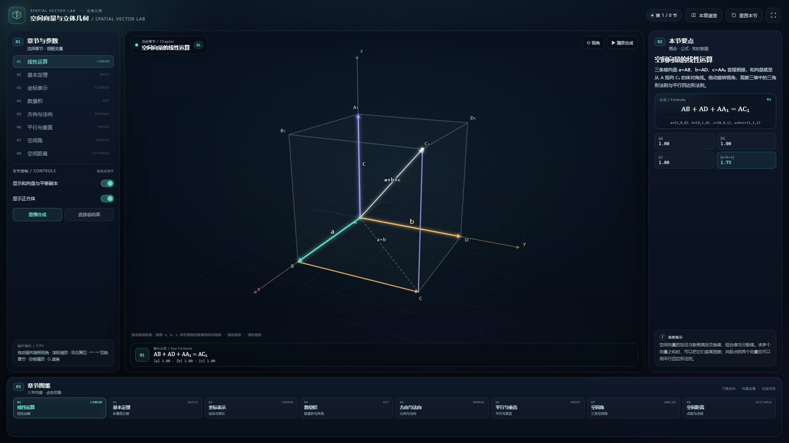

# 空间向量与立体几何 · Spatial Vector Lab

一个用于空间向量章节教学的单文件三维演示：把空间向量的线性运算、基本定理、坐标表示、数量积、方向向量与法向量、平行垂直证明、空间角与空间距离，放进同一个可旋转、可缩放的立方体场景中。

直接用浏览器打开 [index.html](index.html) 即可，**无需联网、无需安装依赖、无需启动服务**。



---

## 快速开始

1. 双击 `index.html`（推荐 Chrome / Edge / Firefox / Safari 近年版本）。
2. 在左栏「章节与参数」中点击 01–08 切换章节，或点击底部「章节图鉴」卡片。
3. 在画布上**拖动旋转视角**，滚轮缩放，双击或点击「⟲ 视角」恢复默认视角。
4. 调节左栏滑块、开关和按钮，观察向量、平面、角度与距离的实时变化。
5. 点击顶部「本章速查」查看八节公式、判定方法与常见易错点；「重置本节」恢复默认状态。

键盘：`←` / `→` 切换章节，`空格` 播放/暂停（仅 01），`R` 重置本节与视角，`G` 打开/关闭本章速查，`Esc` 关闭速查。

### 课堂演示路线

建议按下面的顺序使用：

1. **01 线性运算**：播放 a+b+c 的合成，观察三条棱向量如何得到体对角线 AC₁。
2. **02 基本定理**：调 x、y、z，看斜基底下的平行六面体与唯一分解。
3. **03 坐标表示**：调节 P 的坐标，比较 OP 的坐标、投影与模长。
4. **04 数量积**：调节 b 的方向，观察数量积、夹角与投影的联动。
5. **05 方向与法向**：切换线 AC 与 BD₁，比较 n·d 的符号与线面位置关系。
6. **06 平行与垂直**：逐个切换四条结论，先看几何，再看向量运算。
7. **07 空间角**：切换异面直线角、线面角、二面角，比较三种角的公式。
8. **08 空间距离**：对比点面距与点线距，理解投影与叉积的几何意义。

---

## 界面说明

| 区域 | 内容 |
| --- | --- |
| 01 章节与参数 | 八节纵向导航、当前节的滑块/开关/按钮、操作提示 |
| 中部三维舞台 | 可旋转的正方体与坐标系；左上角当前章节徽标；底部公式条（核心公式 + 实时读数）；「⟲ 视角」 |
| 02 本节要点 | 概念说明、公式卡与数值式、实时数据卡、观察提示 |
| 03 章节图鉴 | 八张章节卡片，点击切换并与左栏导航联动高亮 |

颜色约定：青色用于向量 a 或直线 AC，金色用于向量 b 或直线 BD₁，紫色用于基底 e₃ 或平面 ACD₁，玫红用于法向量与距离，绿色用于结论性向量。

---

## 八节内容

| 节 | 核心公式 | 可交互与观察点 |
| --- | --- | --- |
| 01 线性运算 | `AB + AD + AA₁ = AC₁` | 播放 a+b+c 的合成；显示平移副本、a+b 与体对角线；可隐藏正方体 |
| 02 基本定理 | `v = x e₁ + y e₂ + z e₃` | 调节 x、y、z；显示不两两垂直的斜基底、分解路径与平行六面体 |
| 03 坐标表示 | `|OP| = √(x²+y²+z²)` | 调节 P 的 x、y、z；显示到坐标轴、坐标平面的投影与坐标盒 |
| 04 数量积 | `a·b = a₁b₁+a₂b₂+a₃b₃ = |a||b|cos θ` | 调节 b 的三个分量；显示 a·b、夹角与 b 在 a 上的投影；一键垂直/平行 |
| 05 方向与法向 | `n · d = 0 ⇔ l ∥ α` | 切换直线 AC / BD₁；显示平面 ACD₁ 与法向量 n；比较 n·d 的符号 |
| 06 平行与垂直 | `a·b=0 ⇔ a⊥b`，`a×b=0 ⇔ a∥b` | 四条结论一键切换：AC₁⊥BD、AB₁∥DC₁、A₁B₁∥面ABCD、AC₁⊥面A₁BD |
| 07 空间角 | 见下文三种角 | 异面直线角 60°、线面角 45°、二面角 54.7°；显示辅助线、法向量与角弧 |
| 08 空间距离 | `d = |n·AP|/|n|`，`d = |AP×d|/|d|` | 点 B₁ 到平面 ACD₁ / 直线 AC；显示垂足、垂线段与距离 |

---

## 数学内容

### 1. 空间向量的线性运算

空间向量与平面向量一样，满足三角形法则和平行四边形法则。以正方体的三条棱为向量：

```text
a = AB = (1, 0, 0)
b = AD = (0, 1, 0)
c = AA₁ = (0, 0, 1)
a + b + c = AC₁ = (1, 1, 1)
```

加法满足交换律、结合律；数乘满足分配律。多个向量首尾相接，和向量由第一个起点指向最后一个终点。

### 2. 空间向量基本定理

若 `e₁、e₂、e₃` 不共面，则空间中任意向量 `v` 都存在唯一一组实数 `(x, y, z)`，使

```text
v = x e₁ + y e₂ + z e₃
```

三个基底向量不要求两两垂直，也不要求长度为 1；只要不共面，就能唯一表示空间中的任意向量。当它们两两垂直且长度为 1 时，就是空间直角坐标系的坐标向量。

### 3. 空间向量的坐标表示

建立空间直角坐标系后：

```text
P₁P₂ = (x₂−x₁, y₂−y₁, z₂−z₁)
|a| = √(a₁² + a₂² + a₃²)
```

本节以 A 为原点、AB、AD、AA₁ 所在直线为 x、y、z 轴，则 A(0,0,0)、B(1,0,0)、D(0,1,0)、A₁(0,0,1)、C₁(1,1,1)。

### 4. 数量积与夹角

```text
a · b = a₁b₁ + a₂b₂ + a₃b₃ = |a||b|cos θ
cos θ = a·b / (|a||b|)，θ ∈ [0°, 180°]
```

当 a、b 为非零向量时，`a·b = 0 ⇔ a ⊥ b`。数量积的符号由夹角决定：锐角为正，直角为 0，钝角为负。

### 5. 方向向量与法向量

- 直线 l 的方向向量 d 平行于 l；
- 平面 α 的法向量 n 垂直于 α 内的任意向量；
- `n·d = 0` 时，直线与平面平行或在平面内；
- `d ∥ n` 时，直线与平面垂直。

判断线面平行时，除了 `n·d=0`，还要确认直线不在平面内。

### 6. 平行与垂直的判定

| 位置关系 | 向量条件 |
| --- | --- |
| 线线平行 | 方向向量共线：`a × b = 0` |
| 线线垂直 | 方向向量数量积为 0：`a · b = 0` |
| 线面平行 | `n · d = 0`，且直线不在平面内 |
| 线面垂直 | `d ∥ n` |
| 面面平行 | 法向量共线：`n₁ × n₂ = 0` |
| 面面垂直 | 法向量数量积为 0：`n₁ · n₂ = 0` |

本节用正方体验证：`AC₁ ⊥ BD`、`AB₁ ∥ DC₁`、`A₁B₁ ∥ 平面 ABCD`、`AC₁ ⊥ 平面 A₁BD`。

### 7. 空间角

| 角 | 范围 | 向量公式 |
| --- | --- | --- |
| 异面直线所成角 | `(0°, 90°]` | `cos θ = |a·b| / (|a||b|)` |
| 直线与平面所成角 | `[0°, 90°]` | `sin θ = |d·n| / (|d||n|)` |
| 二面角 | `[0°, 180°]` | 用法向量求，再结合实际图形取角或补角 |

- 异面直线角：把两条直线的方向平移到同一点，取锐角；
- 线面角：方向向量与法向量夹角的余角，所以用 sin；
- 二面角：在棱上取一点，分别在两个半平面内作棱的垂线，两条垂线的夹角就是二面角的平面角。

### 8. 空间距离

```text
点到平面：d = |n · AP| / |n|
点到直线：d = |AP × d| / |d|
```

点面距是斜向量在法向量方向上的投影长度；点线距是以 AP、d 为邻边的平行四边形的高。两平行平面的距离可以在一个平面上任取一点，转化为点面距。

---

## 操作与交互

| 操作 | 效果 |
| --- | --- |
| 在画布上拖动 | 旋转三维视角（水平方向改变方位角，竖直方向改变仰角） |
| 滚轮 | 缩放视角 |
| 双击画布 / 「⟲ 视角」 | 恢复当前章节的默认视角 |
| 拖动左栏滑块 | 改变坐标、系数、向量分量等参数 |
| 开关 | 显示/隐藏辅助线、投影、坐标盒、法向量、平面等 |
| 「本章速查」 | 打开八节公式、易错点与课堂路线 |
| `←` / `→` | 切换上一节 / 下一节 |
| `空格` | 播放/暂停合成动画（仅 01） |
| `R` | 重置本节与视角 |
| `G` / `Esc` | 打开 / 关闭本章速查 |

### URL 参数

```text
index.html?section=6
index.html?section=angles
```

- `section` 可写 1–8 的数字，也可写章节 key：`linear`、`basis`、`coordinates`、`dot`、`normal`、`proof`、`angles`、`distance`。
- 适合课堂固定打开某一节，或截图时复用链接。

---

## 设计说明

- **单文件**：HTML、CSS、原生 Canvas 2D JavaScript 全部写在 `index.html` 内，无外部字体、图片、CDN 或网络请求。
- **三维渲染**：自建透视投影与轨道相机，支持拖动旋转、滚轮缩放；正方体的可见面、遮挡棱、坐标轴、平面与向量均按投影绘制。
- **布局**：沿用同系列项目的三栏工作区（章节与控制 / 舞台 / 要点与数据）+ 底部章节图鉴；窄屏自动改为纵向堆叠。
- **可读性**：画布文字随舞台尺寸调整字号，并带深色描边；重要向量与平面使用独立配色。
- **实时读数**：公式卡同时给出符号式与当前数值式，右侧数据卡随滑块实时更新。

---

## 文件结构

```text
index.html    单文件三维教学演示（全部 HTML / CSS / JS）
README.md     本说明
preview.png   1920×1080 预览图（“线性运算”一节）
```

---

## 验证与兼容性

- 独立数值断言覆盖 8 节核心公式：225 项全部通过，包含基底不共面、坐标分解、数量积、法向量、四条证明结论、三种空间角与两类距离。
- 在 Edge 无头浏览器中逐节切换 8 个章节，并测试直线切换、四条证明预设、三种空间角、两种距离子模式，未出现 JavaScript 错误。
- 在 1920×1080、1366×768、390×844 等视口检查布局，无页面级横向溢出；移动端按“舞台 → 章节与控制 → 要点 → 图鉴”堆叠。
- 支持 Canvas 2D、CSS 自定义属性与 ES2015+ 的现代浏览器。

---

## 已知边界

- 05–08 节使用固定的正方体与几何构型（如平面 ACD₁、平面 A₁BD），便于课堂快速切换结论；暂不支持自由拖动三维点。
- 三维投影下，不同深度的点、线与标签可能重叠；可通过旋转视角、缩放或隐藏辅助元素来避让。
- 角度与距离读数按两位小数显示，精确值以公式卡中的根式与分数为准。
- 相机只支持环绕与缩放，不提供平移；画布拖动始终用于旋转视角。
