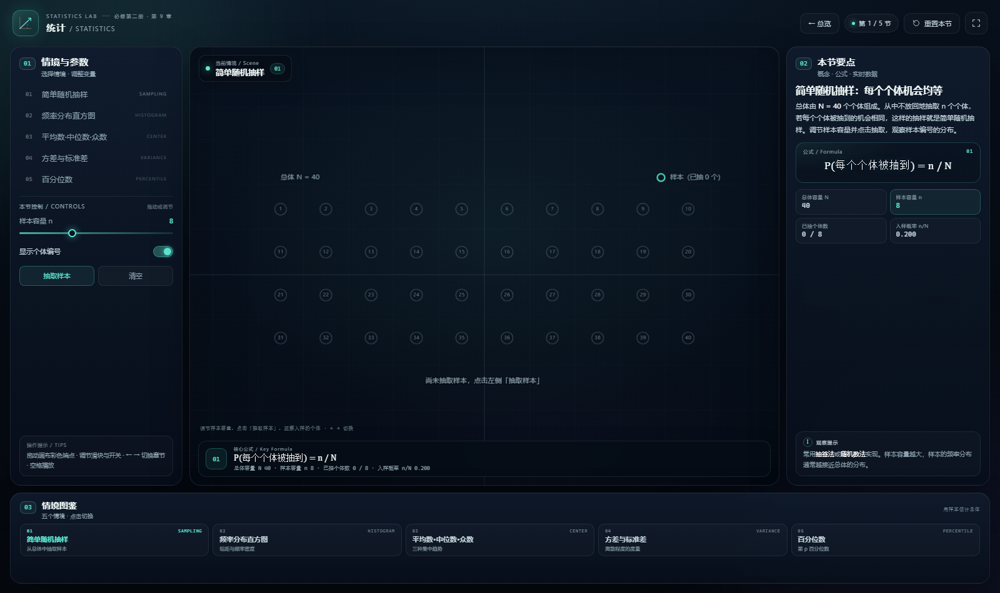

# 统计 · Statistics

一个可直接双击打开的单文件动态教学网页，对应必修第二册 · 第 9 章。
本页包含 5 个可拖拽、可调节的教学情境，图形、公式与实时数据同步联动。

直接用浏览器打开 [index.html](index.html) 即可，**无需联网、无需安装依赖、无需启动服务**。



---

## 快速开始

1. 双击 `index.html`（推荐 Chrome / Edge / Firefox / Safari 近年版本）。
2. 在左侧「情境与参数」中切换 5 个情境，或点击底部「情境图鉴」。
3. 拖动画布中的彩色端点，调节左栏滑块、开关与按钮。
4. 顶部「重置本节」恢复当前情境；「全屏」适合课堂投屏。
5. 键盘 `←` / `→` 切换情境。

---

## 五个情境

| 编号 | 情境 | 英文 | 关注点 |
| --- | --- | --- | --- |
| 01 | 简单随机抽样 | SAMPLING | 从总体中抽取样本 |
| 02 | 频率分布直方图 | HISTOGRAM | 组距与频率密度 |
| 03 | 平均数·中位数·众数 | CENTER | 三种集中趋势 |
| 04 | 方差与标准差 | VARIANCE | 离散程度的度量 |
| 05 | 百分位数 | PERCENTILE | 第 p 百分位数 |

---

## 交互与界面

- 左栏：情境列表与本节参数控件（滑块、开关、按钮）。
- 中栏：Canvas 动态图、当前情境徽标、底部核心公式与实时读数。
- 右栏：概念说明、公式卡、实时数据卡与观察提示。
- 底栏：情境图鉴，点击可在五个情境之间快速跳转。

颜色约定：每个情境使用独立主题色；拖动端点带环形手柄，悬停变手型。

---

## 文件结构

```text
index.html    单文件教学演示（HTML / CSS / 原生 Canvas JS）
README.md     本说明
preview.png   页面预览图
```

---

## 说明

- 页面无外网依赖，所有图形与文字均使用系统能力绘制。
- 画布按 devicePixelRatio 缩放；窄屏自动改为纵向堆叠。
- 拖动端点被限制在当前视野内；刷新后回到第一个情境。
